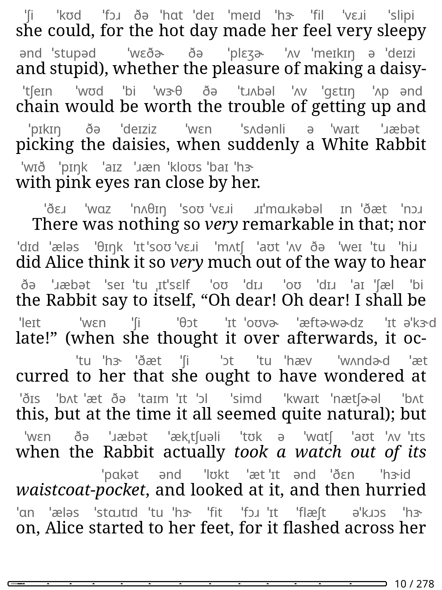
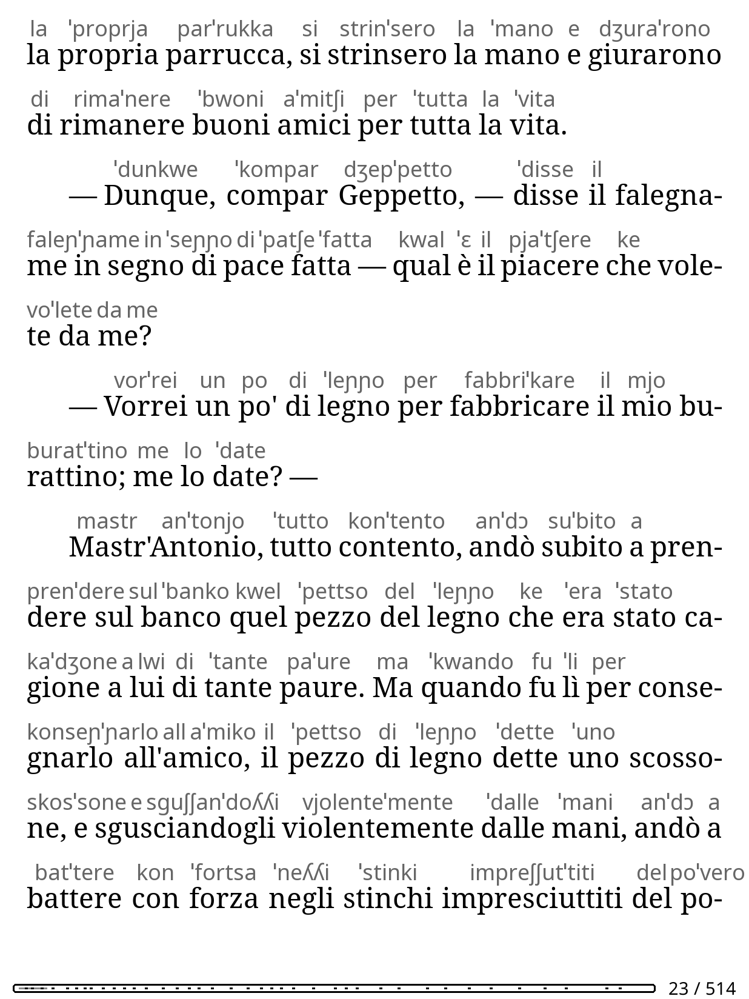
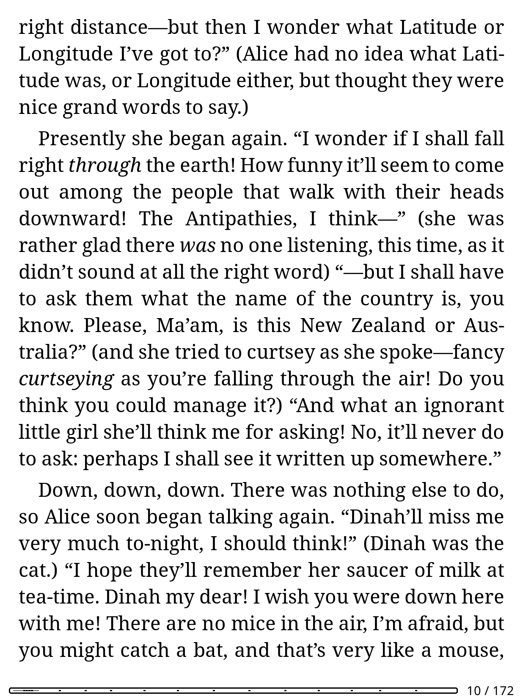
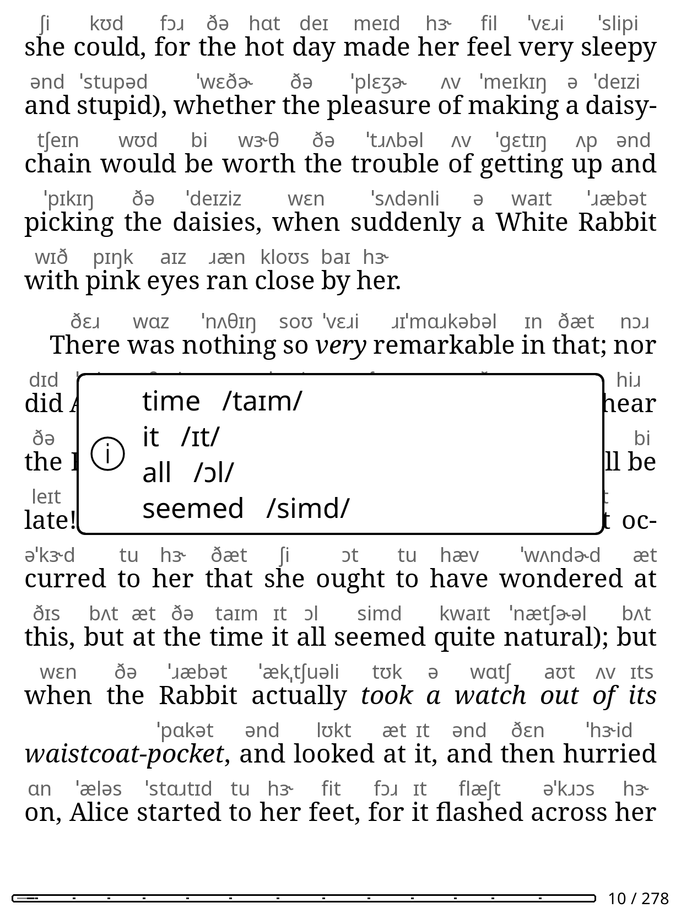

# IPA pronunciation for KOReader

Shows the IPA pronunciation above every word of an English or Italian EPUB, with a per-book toggle. The book file is never modified.

| English UK | Italian (experimental) |
|---|---|
|  |  |

Screenshots come from Alice in Wonderland (public domain) and a short generated Italian test text, in the KOReader Linux emulator at the Kindle Paperwhite 11th gen resolution.

## Status and limits

- English US and UK are dictionary based and reliable for common words. Words missing from the dictionary show nothing.
- **Italian is experimental.** Pronunciation comes from rules: stress on the penultimate syllable unless the word is accented, ends in -abile, -ibile or -evole, or is in a small list of common words stressed on the third to last syllable (tavolo, aquila, subito). Every other such word gets the wrong stress, notably third person plural verbs (parlano, guardano). Open and closed e/o are not marked, `z` is never `dz`.
- Works only in page view mode and only on EPUB and other reflowable documents. PDF and scroll mode show nothing.
- Line spacing grows to make room for the IPA row, so a page holds fewer lines (see below). It goes back to 100% when you turn the overlay off.
- Words with a single vowel get no stress mark.
- No audio.
- Tested on a Kindle Paperwhite 11th gen and the KOReader Linux build, both v2026.07.1. Older versions are untested.

Line spacing, overlay off and on:

| Off | On |
|---|---|
|  |  |

## Install

Download `ipaoverlay.koplugin.zip` from the releases page, unzip it and copy the `ipaoverlay.koplugin` folder to `koreader/plugins/` on the device (tested on Kindle, other KOReader devices such as Kobo should work but are untested), then restart KOReader.

From a checkout on macOS: `rsync -rt --delete --exclude '._*' ipaoverlay.koplugin/ <device>/koreader/plugins/ipaoverlay.koplugin/`.

Menu: Tools tab, "IPA pronunciation". Options: size, color, language (Automatic, English US, English UK, Italian). It can also be bound to a gesture (action "Toggle IPA pronunciation").

Select a word and tap "Pronunciation" in the popup to see its IPA, also when the overlay is off.

## Dictionaries

No dictionary is bundled. The first time an English engine is needed the plugin asks to download it (about 5 MB, needs WiFi) into the `ipaoverlay/` folder of the KOReader data directory (`koreader/ipaoverlay/` on Kindle). Files come from pinned commits of the upstream repositories and are verified with SHA256. Italian needs no download.

See NOTICE for sources and licenses. The UK data is GPL-3.0.

## Performance

On the Paperwhite 11th gen (from the KOReader log):
- A page scan takes about 0.1 s for 100 words, and every page is cached.
- Opening a book to the first IPA took about 9 s, which includes book layout and loading the dictionary into memory (about 25 MB of Lua memory measured on x86).
- The one-time download of the 3.6 MB US dictionary, including the SHA256 check, took 3.6 s.

## How it works

An overlay draws the IPA above each word of the current page when the page is painted. Selection, highlights, dictionary and translation keep working on the original text.

- crengine returns one box per line for a text range, so every word is queried on its own and the result is cached per page.
- Line spacing is computed from the IPA size when the overlay is turned on.
- English US: CMUdict, ARPAbet converted to IPA on the device.
- English UK: ipa-dict `en_UK` with the stress mark moved to the syllable start, words missing there use CMUdict with UK vowels and r-dropping.
- The IPA is drawn with KOReader's bundled Noto Sans, no font is shipped.
- If painting fails the overlay turns itself off for that book and shows a notice.
- Languages are entries of `engines.lua`: id, label, ISO codes for auto detection, needed files, `create`.

## Development

    make test       # luajit tests in Docker
    make lint       # luacheck and ruff in Docker
    make emulator   # smoke test in the KOReader Linux build, screenshots go to OUT_DIR
    make zip        # release zip

`tools/build_ipadict_uk.py` is the reference for `uk_stress.lua`. `tests/uk_stress_fixtures.lua` holds its outputs, regenerate them if the rule changes.

## License

AGPL-3.0-or-later, see LICENSE. Dictionary data has its own licenses, see NOTICE.
